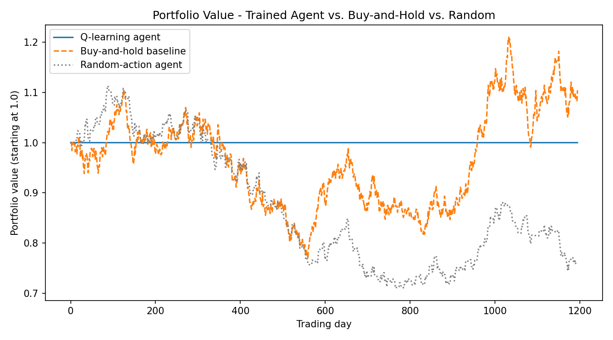

# RL Trading Agent

A tabular Q-learning agent that learns to trade a simulated commodity
price series (Buy / Sell / Hold), built from scratch with just numpy,
pandas, and matplotlib - no Gymnasium, PyTorch, or TensorFlow, since I
didn't have a reliable way to install those in the environment I built
this in.

## Files

- `rl_trading_agent.py` - environment, agent, training loop, everything

## How to run it

```
pip install numpy pandas matplotlib     # if you don't already have them
python3 rl_trading_agent.py
```

That's it, no API keys or extra setup needed. It'll print training
progress and final results to the terminal, and save two charts into a
`rltrader_output` folder (`learning_curve.png` and
`portfolio_vs_baseline.png`).

## What it does

- Simulates ~1200 days of gold-like price data (Geometric Brownian
  Motion, same idea as my other ML project)
- Builds a simple trading environment: state = (recent price trend
  bucket, whether the agent currently holds the asset), actions =
  Buy / Sell / Hold
- Trains a tabular Q-learning agent over 500 episodes
- Compares the trained agent's performance against a buy-and-hold
  baseline and a random-action baseline

## Demo

Training output from a full run: average reward per 50 episodes as exploration (epsilon) decays,
then the final comparison against two baselines.


| Learning curve | Portfolio value vs. baselines |
|---|---|
|  |  |

## Heads up on the result

The trained agent in this run learned to **never buy**: it holds cash the
whole time, so its return is exactly 0.00%. That's a real result, not a
bug, and I think it's more useful to report honestly than to rerun until
the number looks better.

**Why it happened.** In the final Q-table, every *Buy* value is negative
across all five trend buckets, while *Hold* sits at exactly 0. Holding
cash never loses money and never pays the 0.1% transaction fee, so the
agent found a safe local optimum: never buy, never lose. Given how the
rewards are defined, that really is reward-maximizing. It just gives up
the 10.43% that buy-and-hold earned.

**What it did learn.** It comfortably beat the random-action baseline
(-24.28%), which lost value mostly to fees and to holding through bad
days. So it learned to avoid pointless, costly trades, but not that some
trades are worth the risk.

**What I'd try next**
- A richer state, such as recent volatility, so the agent can tell a
  strong uptrend from a shaky one
- Rewards that don't quietly punish all risk: a lower transaction cost,
  or a small bonus for holding through a net-positive stretch
- Many more training episodes, since tabular training is cheap
- Risk-adjusted rewards, as in direct reinforcement trading
  (Moody & Saffell, 2001)

This kind of overly cautious "do nothing" policy is a well-known failure
mode in reinforcement learning in general, not just in trading.

## Author

**Ousmana Tunkara** · [GitHub @Kodelack47](https://github.com/Kodelack47)

Licensed under the [MIT License](LICENSE).
