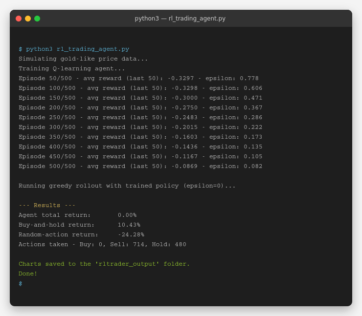
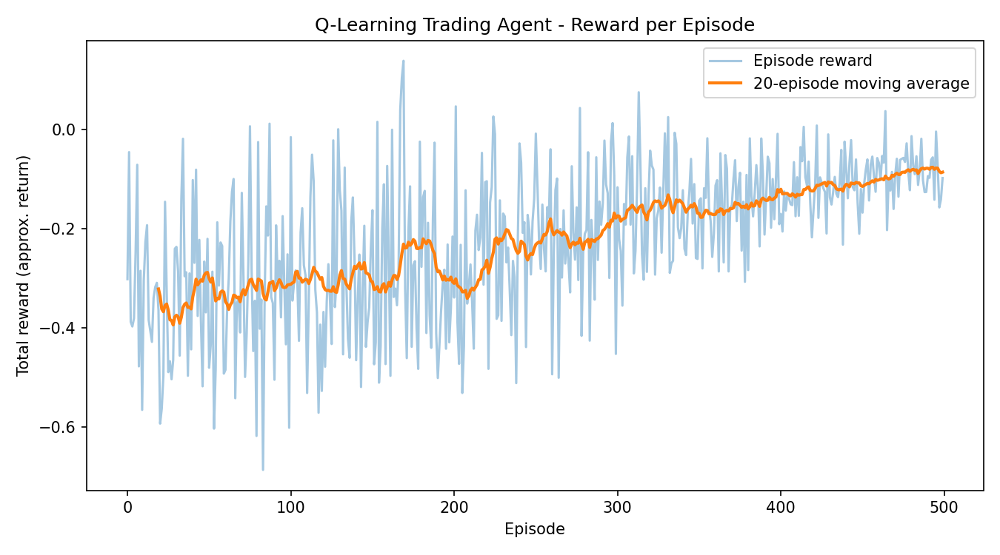

# RL Trading Agent

A tabular Q-learning agent that learns to trade a simulated commodity
price series (Buy / Sell / Hold), built from scratch with just numpy,
pandas, and matplotlib - no Gymnasium, PyTorch, or TensorFlow, since I
didn't have a reliable way to install those in the environment I built
this in.

## Files

- `rl_trading_agent.py` - environment, agent, training loop, everything

## How to run it

```
pip install numpy pandas matplotlib     # if you don't already have them
python3 rl_trading_agent.py
```

That's it, no API keys or extra setup needed. It'll print training
progress and final results to the terminal, and save two charts into a
`rltrader_output` folder (`learning_curve.png` and
`portfolio_vs_baseline.png`).

## What it does

- Simulates ~1200 days of gold-like price data (Geometric Brownian
  Motion, same idea as my other ML project)
- Builds a simple trading environment: state = (recent price trend
  bucket, whether the agent currently holds the asset), actions =
  Buy / Sell / Hold
- Trains a tabular Q-learning agent over 500 episodes
- Compares the trained agent's performance against a buy-and-hold
  baseline and a random-action baseline

## Demo

Training output from a full run: average reward per 50 episodes as exploration (epsilon) decays,
then the final comparison against two baselines.



| Learning curve | Portfolio value vs. baselines |
|---|---|
|  |  |

## Heads up on the result

The trained agent in this run ended up learning to never buy at all -
it just holds cash the whole time. That's a real result, not a bug I
left in by accident. See the Discussion section of the report for why
I think that happened and what I'd change.

## Author

**Ousmana Tunkara** · [GitHub @Kodelack47](https://github.com/Kodelack47)

Licensed under the [MIT License](LICENSE).
